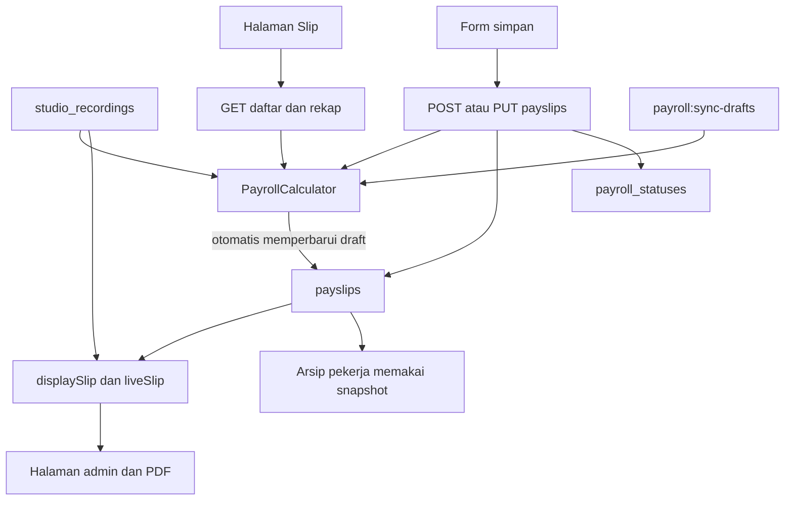

# Audit Slip — 15 November 2026

Audit halaman, skema database, backend, dan pemicu otomatis. Tidak mengubah
perilaku aplikasi atau data produksi. Jumlah duplikat aktual di produksi belum
diukur. Graphify ditelusuri dengan budget 1.000 token; fingerprint tertinggal,
sehingga temuan diverifikasi langsung pada source terbaru.

## Bagan alur

Identitas payroll memakai nama teks dan label periode. Tabel payslips hanya
memiliki index employee_name + period, sedangkan payroll_statuses memiliki unique
worker_name + period. Tidak ada contributor_id atau rentang tanggal terstruktur
pada slip (migrasi 2026_11_02_000001_create_payroll_tables.php).

## Temuan utama

### P1 — Slip ganda tanpa aturan versi yang konsisten

`PayslipController.php:94-117` selalu menjalankan Payslip::create. Dua POST
identik berhasil membuat dua baris. Tidak ada idempotensi atau unique constraint.
Form memakai PUT bila sudah memiliki slipId, tetapi dua tab/form baru atau retry
tetap bisa mengirim POST ganda. Tombol disabled bukan pengaman backend.

`PayrollCalculator.php:83,124` memilih slip terakhir untuk live/rekap; daftar dan
arsip pekerja menampilkan semua versi. `PayrollPaymentStatus.php:12-15` mengubah
status semua versi sekaligus. Komentar service memang mengizinkan beberapa versi,
tetapi tidak ada status current/superseded atau relasi revisi.

Perbaikan: sepakati satu slip aktif per pekerja/periode dan pisahkan revisi;
tambahkan idempotensi serta constraint. Rekonsiliasi data lama sebelum migrasi,
jangan menghapus baris otomatis hanya karena nama/periode sama.

### P1 — Carry-over hilang pada display/PDF draft; ID dapat berganti

`PayrollCalculator.php:86` menghitung liveSlip hanya dengan evidence dan bonus,
tanpa carry-over tersimpan. `displaySlip():108` menimpa data slip yang diminta
dengan liveSlip yang mengambil slip terakhir.

Reproduksi: carry-over Rp25.000 tetap ada di DB tetapi display mengembalikan 0;
ketika dua versi tersedia, display slip pertama mengembalikan ID versi kedua.
Ekspor menyimpan file_path pada slip yang diminta walaupun isi dapat berasal dari
versi terakhir (`PayslipController.php:189-190`).

Perbaikan: hitung display dari ID yang diminta dan pertahankan bonus, carry-over,
identitas, serta metadata miliknya. Satukan representasi rekap, detail, dan PDF.

### P1 — Lock tidak melindungi perubahan lewat API

`PayslipController.php:121-145` menerima PUT pada slip sudah/locked. Reproduksi
mengubah snapshot 1 jam menjadi 3 jam, dengan is_locked tetap true. DELETE juga
tidak membatasi slip final. Perlindungan pada summary/display tidak menyeluruh.

Perbaikan: tolak perubahan final di backend; sediakan revisi dengan pelaku/alasan.

### P1 — Klaim carry-over belum diamankan saat simpan

Store/update menerima nominal dan rincian carry-over dari browser tanpa memeriksa
ulang saldo (`PayslipController.php:66-76,98-104,125-131`).
`detectPendingCarryOver()` mengurangi klaim slip lain ketika membaca saldo saja;
tidak ada reservasi/constraint klaim saat simpan. Slip sumber juga tidak diwajibkan
sudah dibayar atau locked (`PayrollCalculator.php:187-240`).

Dua form dapat membaca saldo sama lalu mengklaimnya bersama. Draft sumber bisa
disinkronkan ke nilai live setelah selisihnya masuk periode berikutnya. Ini risiko
pembayaran ganda dari source; konkurensi belum direproduksi.

Perbaikan: validasi saldo/sumber final di server dalam transaksi yang menserialisasi
klaim; simpan ledger alokasi dengan identitas sumber stabil.

### P2 — Membuka halaman otomatis menulis ulang draft

Logika sinkronisasi ada di index controller, summary kalkulator, dan command
SyncDraftPayslips. Halaman memanggil GET api/slips saat init
(`public/assets/app.js:445-455`). Reproduksi: GET daftar mengubah draft manual
1 jam menjadi 2 jam. Evidence diganti penuh, sehingga detail manual/gambar/catatan
yang tidak ada pada evidence live berisiko hilang.

Exception index ditelan; command memberi warning tetapi tetap SUCCESS. Guard
exists mempertahankan nilai lama ketika seluruh rekaman hilang/dipindah; summary
berbasis kelompok rekaman tidak menampilkan pekerja tanpa rekaman.
Pemilihan draft dan update juga tidak atomik terhadap pembayaran: request GET
terlambat berisiko menulis setelah slip dibayar. Konkurensi belum diuji.

Perbaikan: jadikan GET hanya membaca, satukan sinkronisasi eksplisit dengan aturan
kepemilikan field, proteksi finalisasi atomik, dan laporan kegagalan.

### P2 — Identitas, periode, dan angka historis belum seragam

Nama/label dipakai untuk exact match. Resolver menerima beberapa label untuk
rentang sama, tetapi store/update tidak mengkanonisasi periode. Perubahan nama
atau label dapat memutus hubungan slip/status/rekaman/carry-over.
Summary slip final menggabungkan THP snapshot dengan jam/statistik live; base
dihitung memakai tarif konfigurasi kini, bukan tarif historis.

Perbaikan: contributor_id dan period_id stabil, tarif snapshot, serta pemisahan
jam live dari jam yang telah dibayar pada tampilan.

### P2 — Ekspor berulang membuat file PDF baru

`PayslipPdf.php:37-43` membuat nama acak serta owner JSON pada tiap ekspor.
Ekspor admin menimpa file_path tanpa membersihkan file lama pada jalur ini.
Ini dapat menjelaskan PDF ganda, berbeda dengan baris slip ganda.
Perbaikan: cache berdasarkan ID/revisi snapshot dan kelola retensi file.

## Otomatisasi yang ditemukan

- Scheduler repository menyinkronkan rekaman dan streak; tidak menjadwalkan
  payroll:sync-drafts di routes/console.php.
- Command sync-drafts memperbarui slip yang sudah ada, bukan membuat baris baru.
- GET daftar/rekap memperbarui draft. Pembuatan baris baru pada jalur web yang
  diaudit berasal dari POST simpan.
- Cron eksternal/server belum diperiksa. Belum ada bukti cron membuat slip ganda.

## Validasi dan batas pemeriksaan

Empat probe sementara, PHPUnit RefreshDatabase dengan SQLite :memory:.
Perintah: `php artisan test --compact --filter=SlipAuditProbeTest`.
Hasil: **4 passed, 15 assertions**. Probe memeriksa keberadaan perilaku bermasalah,
bukan menyatakan fitur benar; probe dihapus setelah audit.

| Reproduksi | Hasil aktual |
| --- | --- |
| POST sama dua kali | Dua respons OK dan dua baris |
| Display draft carry-over, dua versi | Carry-over 0 dan ID versi terakhir; DB tetap Rp25.000 |
| GET daftar sesudah rekaman berubah | Jam tersimpan berubah 1 menjadi 2 |
| PUT slip sudah/locked | Jam berubah 1 menjadi 3; locked tetap true |

Kalkulator mengembalikan base_thp yang tidak ada di skema, tetapi store/update
berhasil dalam pengujian. Ini bukan bukti SQL error. Jangan menyatakan simpan
gagal atau menambah kolom hanya berdasarkan key tersebut.

Tidak ada build/full suite/rebuild graph karena hasil task hanya dokumentasi.
Perbaikan payroll selanjutnya memerlukan regression tests dan full suite sesuai
AGENTS.md. Prioritas: konsistensi display/PDF, proteksi finalisasi/carry-over,
aturan slip aktif/revisi, lalu sinkronisasi dan normalisasi identitas.
